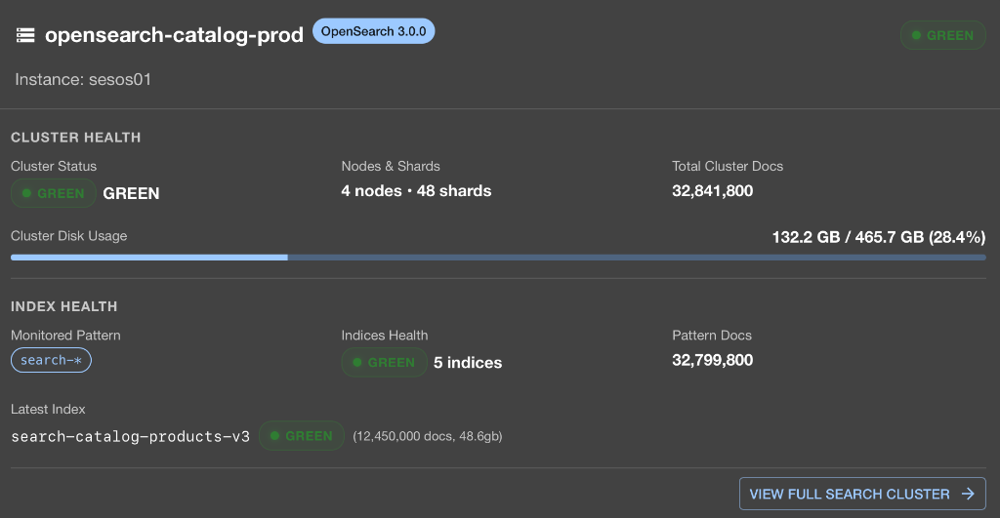
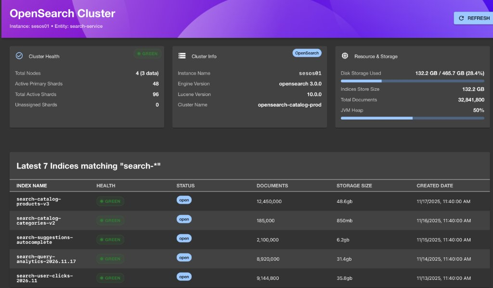

# Backstage OpenSearch & Elasticsearch Plugins

[](https://backstage.io/)
[](https://opensearch.org/)
[](https://www.elastic.co/)
[](https://www.typescriptlang.org/)
[](LICENSE)

A production-grade, enterprise-ready Backstage plugin suite for monitoring and visualizing **OpenSearch (1.x, 2.x, 3.x)** and **Elasticsearch (7.x, 8.x, 9.x)** clusters directly within your Backstage Software Catalog.

---

## Visual Tour

### 1. Catalog Component Overview Health Card
Displays real-time cluster health, node and shard topology, disk storage usage, and matched index patterns directly on the entity's Overview tab:



### 2. Dedicated Search Cluster Dashboard
Deep-dive inspection tab (`/search-cluster`) with resource telemetry, JVM heap metrics, and recent indices sorting:



---

## Key Features

- **Multi-Engine Support**: Seamless compatibility with both OpenSearch (`1.x`, `2.x`, `3.x`) and Elasticsearch (`7.x`, `8.x`, `9.x`).
- **Dynamic Auto-Detection**: Automatically detects cluster distribution and engine versions without manual configuration flags.
- **Backstage New Frontend & Backend Systems**:
  - Full support for Backstage's **New Backend System** (`createBackendPlugin`).
  - Full support for Backstage's **New Frontend System** (`createFrontendPlugin`, `EntityCardBlueprint`, `EntityContentBlueprint` in `/alpha`).
  - Backward-compatible with legacy Backstage systems (Classic `createRouter` and JSX `EntityPage.tsx`).
- **Zero-Blink Stable UI**: Strict memoization and scalar hook dependencies guarantee smooth, flicker-free rendering and stable manual refreshes.
- **Enterprise Security**:
  - Custom TLS Certificate Authorities via file path or inline PEM strings.
  - Basic Auth, API Keys, Bearer Tokens, and custom reverse-proxy headers.
  - Safe credential redaction preventing secret leakage to browsers.
- **Built-in Mock Clusters Daemon**: Instant local development and testing with simulated OpenSearch 3.x and Elasticsearch 9.x clusters—no Docker or heavy JVM setup required.

---

## Repository Structure

```
backstage-opensearch-plugins/
├── docs/                               # Comprehensive Documentation
│   ├── getting-started/                # Installation and Quickstart guides
│   ├── configuration/                  # app-config.yaml specification
│   ├── catalog-integration/            # Entity YAML annotations
│   ├── architecture/                   # Design overview and diagrams
│   ├── troubleshooting/                # Common error resolutions
│   └── images/                         # UI screenshots
├── plugins/
│   ├── opensearch-backend/             # Backend plugin package
│   │   ├── src/
│   │   │   ├── service/router.ts       # Express router & endpoints
│   │   │   ├── service/SearchClusterClient.ts # Upstream cluster client
│   │   │   ├── plugin.ts               # New Backend System entrypoint
│   │   │   └── schema.ts               # Zod validation schemas
│   └── opensearch/                     # Frontend plugin package
│       ├── src/
│       │   ├── api/                    # ApiRef & SearchClusterClient
│       │   ├── components/             # Overview Card, Cluster Grid, Indices Table
│       │   └── alpha.tsx               # New Frontend System declarative blueprints
├── scripts/
│   ├── mock-clusters.mjs               # Standalone ES 9.x & OS 3.x mock server
│   ├── run-all-tests.mjs               # Test suite runner
│   └── test-live-instances.mjs         # E2E integration test runner
└── README.md
```

---

## Quick Installation

Depending on your distribution preference, you can integrate the plugins directly from source into your Backstage monorepo or install from NPM:

### Option A: Direct Workspace Copy (Recommended for Git Monorepos)
Backstage natively discovers plugins placed under the `plugins/` directory:

1. Copy the plugin folders into your target Backstage repository:
   ```bash
   cp -r /path/to/backstage-opensearch-plugins/plugins/opensearch <backstage-app>/plugins/
   cp -r /path/to/backstage-opensearch-plugins/plugins/opensearch-backend <backstage-app>/plugins/
   ```

2. Add workspace dependencies to `packages/app/package.json` and `packages/backend/package.json`:
   ```bash
   # In packages/app/package.json:
   #   "@lockum/opensearch-plugin": "workspace:^"
   # In packages/backend/package.json:
   #   "@lockum/opensearch-plugin-backend": "workspace:^"

   yarn install
   ```

### Option B: NPM Registry (If Published to NPM)
```bash
yarn --cwd packages/backend add @lockum/opensearch-plugin-backend
yarn --cwd packages/app add @lockum/opensearch-plugin
```

### 2. Enable in Backend
In `packages/backend/src/index.ts`:
```typescript
backend.add(import('@lockum/opensearch-plugin-backend'));
```

### 3. Enable in Frontend
In `packages/app/src/App.tsx`:
```typescript
import opensearchPlugin from '@lockum/opensearch-plugin/alpha';

export default createApp({
  features: [
    /* ... */
    opensearchPlugin,
  ],
});
```

### 4. Configure `app-config.yaml`
```yaml
searchClusters:
  instances:
    - name: sesos01
      type: opensearch
      url: https://opensearch.corp.internal:9200
      auth:
        username: ${OPENSEARCH_USER}
        password: ${OPENSEARCH_PASS}

    - name: sesdev01
      type: elasticsearch
      url: https://es9.corp.internal:9200
      apiKey: ${ELASTICSEARCH_API_KEY}
```

### 5. Annotate Your Entity
In `catalog-info.yaml`:
```yaml
apiVersion: backstage.io/v1alpha1
kind: Component
metadata:
  name: search-service
  annotations:
    os_instance: sesos01       # Or es_instance: sesdev01
    index_name: search-*       # Monitored index wildcard pattern
spec:
  type: service
  owner: team-search
  lifecycle: production
```

---

## Local Development & Testing

### 1. Start the Mock Cluster Daemon
```bash
yarn mock:clusters
```
*Starts simulated Elasticsearch 9.0.1 on `http://127.0.0.1:9200` and OpenSearch 3.0.0 on `http://127.0.0.1:9201`.*

### 2. Run the Test Suites
```bash
yarn test
```
Runs 31 unit and integration tests across backend configuration, TLS handling, router endpoints, formatters, and frontend components.

---

## Documentation

Explore the complete documentation in the [`docs/`](./docs/README.md) directory:
- [Installation Guide (New & Legacy Systems)](./docs/getting-started/installation.md)
- [5-Minute Quickstart](./docs/getting-started/quickstart.md)
- [Configuration Reference (`app-config.yaml`)](./docs/configuration/app-config.md)
- [Catalog Annotations Reference](./docs/catalog-integration/annotations.md)
- [Architecture & Design Overview](./docs/architecture/overview.md)
- [Troubleshooting & FAQ](./docs/troubleshooting/faq.md)

---

## License

Licensed under the [Apache License, Version 2.0](LICENSE).
