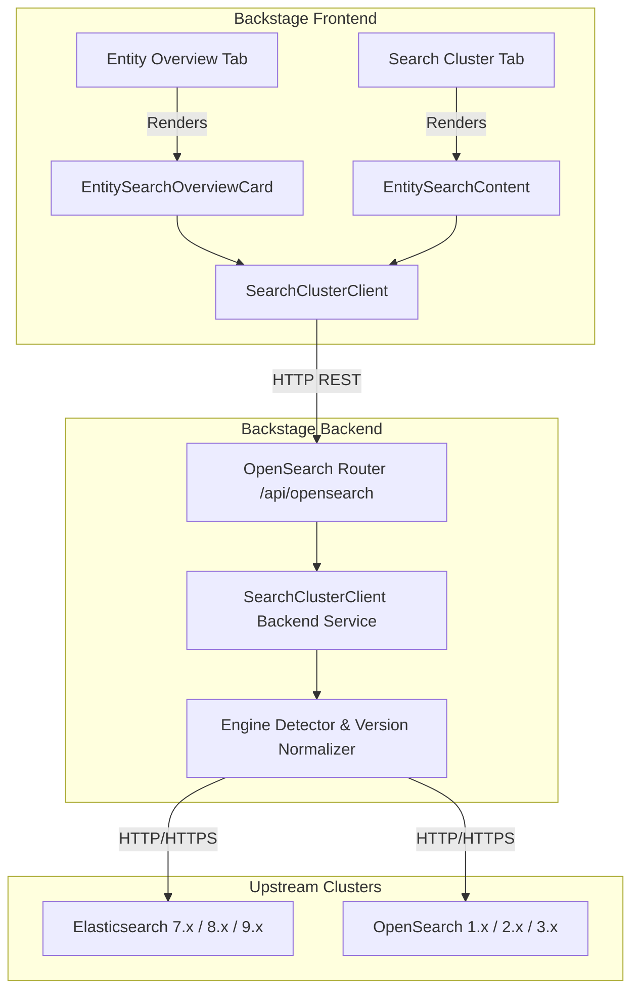

# Architecture Overview

This document describes the design and internal data flow of the OpenSearch and Elasticsearch Backstage plugin suite.

---

## High-Level Architecture Diagram

---

## Key Modules

### 1. Backend Plugin (`@lockum/opensearch-plugin-backend`)
- **`SearchClusterClient`**: Node.js client supporting TLS CA certificates, Basic Auth, API keys, Bearer tokens, and timeouts.
- **`router.ts`**: Express router exposing normalized endpoints:
  - `GET /health`: Plugin health status check.
  - `GET /instances`: Lists configured clusters without exposing sensitive credentials.
  - `GET /instances/:instanceName/summary`: Fetches cluster health, node stats, storage breakdown, and recent indices matching the requested pattern.
  - `GET /instances/:instanceName/health`: Returns raw cluster health.
  - `GET /instances/:instanceName/stats`: Returns raw cluster stats.
  - `GET /instances/:instanceName/indices`: Returns matching indices.
- **`plugin.ts`**: Backstage New Backend System plugin registration with unauthenticated read access for cluster telemetry.

### 2. Frontend Plugin (`@lockum/opensearch-plugin`)
- **`SearchClusterClient`**: Frontend API client implementing `SearchClusterApi`.
- **`EntitySearchOverviewCard`**: Responsive card for the Catalog Entity Overview tab displaying:
  - Cluster Health status (`green`/`yellow`/`red`)
  - Node and shard counts
  - Disk storage utilization bar
  - Monitored pattern health, index count, and document totals
  - Direct navigation button to the full dashboard
- **`EntitySearchContent`**: Full-page dashboard component featuring:
  - Top metrics cards (Health, Info/Version, Resource & Storage)
  - Recent indices table with status, document counts, and creation dates
  - Smooth animated refresh button with stable hooks
- **`alpha.tsx`**: Declarative extensions using `EntityCardBlueprint` and `EntityContentBlueprint` for the New Frontend System.

---

## Security Model

- **No Credential Leakage**: The backend strips all upstream authentication secrets (passwords, tokens, API keys) when exposing `/api/opensearch/instances`.
- **Strict Zod Validation**: Configuration parameters and query parameters are validated with strict schemas.
- **Safe TLS Handling**: Custom CA certificates are applied exclusively to upstream agent instances, keeping global Node.js trust stores intact.
- **Read-Only Scope**: The plugin exclusively calls read-only monitoring APIs (`GET /`, `GET /_cluster/health`, `GET /_cluster/stats`, `GET /_cat/indices`). It does not modify cluster mappings, settings, or documents.
