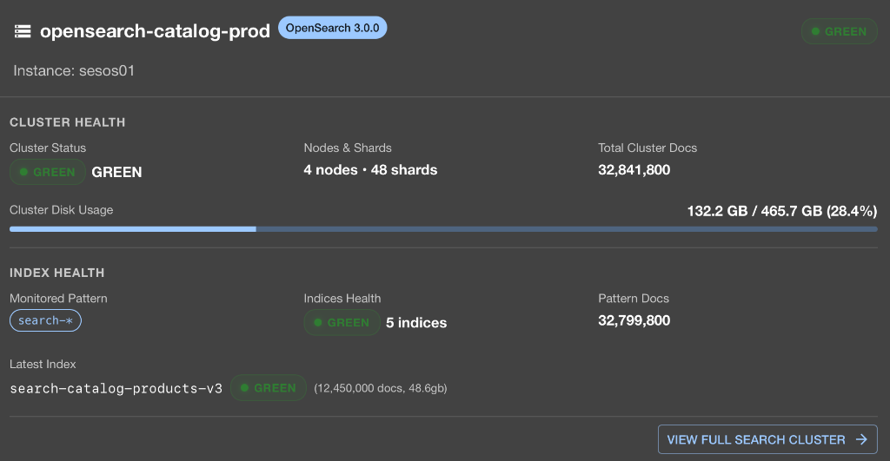

# Installation Guide

This guide covers installing and configuring the **OpenSearch & Elasticsearch Backstage Plugin Suite** in any Backstage instance.

The plugin suite consists of two packages:
- **`@lockum/opensearch-plugin-backend`**: Backend service that connects to clusters, normalizes metrics, and handles authentication/TLS.
- **`@lockum/opensearch-plugin`**: Frontend plugin delivering the Overview Card and dedicated Search Cluster dashboard.

---

## Visual Preview

### 1. Component Overview Card
Displays cluster status, node count, shard allocation, disk usage, and monitored index health directly on the entity's Overview tab:



### 2. Dedicated Search Cluster Tab
Provides comprehensive telemetry, memory/JVM breakdown, and recent indices inspection:


---

## Prerequisites

- Node.js `18.x`, `20.x`, or `22.x+`
- A Backstage application (Backstage `1.24+` recommended)
- Network access from the Backstage backend to your Elasticsearch or OpenSearch cluster(s)

---

## Step 1: Install Packages

In your Backstage root directory:

```bash
# Add backend plugin to packages/backend
yarn --cwd packages/backend add @lockum/opensearch-plugin-backend

# Add frontend plugin to packages/app
yarn --cwd packages/app add @lockum/opensearch-plugin
```

*(If developing locally within a monorepo, you can link them via `workspace:^` in `package.json`.)*

---

## Step 2: Configure the Backend

### Modern Backstage (New Backend System)

In `packages/backend/src/index.ts`, register the plugin:

```typescript
import { createBackend } from '@backstage/backend-defaults';

const backend = createBackend();

// ... other plugins ...

// Add OpenSearch & Elasticsearch plugin
backend.add(import('@lockum/opensearch-plugin-backend'));

backend.start();
```

### Classic Backstage (Legacy Backend System)

If your Backstage instance uses the legacy backend, create `packages/backend/src/plugins/opensearch.ts`:

```typescript
import { createRouter } from '@lockum/opensearch-plugin-backend';
import { Router } from 'express';
import { PluginEnvironment } from '../types';

export default async function createPlugin(
  env: PluginEnvironment,
): Promise<Router> {
  return await createRouter({
    logger: env.logger,
    config: env.config,
  });
}
```

And in `packages/backend/src/index.ts`:

```typescript
import opensearch from './plugins/opensearch';

// Inside makeCreateEnv or root router setup:
const opensearchEnv = useHotMemoize(previous => createEnv('opensearch'));
apiRouter.use('/opensearch', await opensearch(opensearchEnv));
```

---

## Step 3: Configure the Frontend

### Modern Backstage (New Frontend System / Declarative Integration)

In `packages/app/src/App.tsx`, simply include the plugin in your `createApp` features:

```typescript
import { createApp } from '@backstage/frontend-defaults';
import catalogPlugin from '@backstage/plugin-catalog/alpha';
import opensearchPlugin from '@lockum/opensearch-plugin/alpha';

export default createApp({
  features: [
    catalogPlugin,
    opensearchPlugin, // Automatically registers Overview Card and /search-cluster tab
  ],
});
```

### Classic Backstage (JSX EntityPage Integration)

In `packages/app/src/components/catalog/EntityPage.tsx`:

1. Import the components and availability predicate:
   ```tsx
   import {
     EntitySearchOverviewCard,
     EntitySearchContent,
     isSearchClusterAvailable,
   } from '@lockum/opensearch-plugin';
   ```

2. Add the Overview card to `overviewContent`:
   ```tsx
   const overviewContent = (
     <Grid container spacing={3} alignItems="stretch">
       {/* ... other cards (About, Links) ... */}

       <EntitySwitch>
         <EntitySwitch.Case if={isSearchClusterAvailable}>
           <Grid item md={6} xs={12}>
             <EntitySearchOverviewCard />
           </Grid>
         </EntitySwitch.Case>
       </EntitySwitch>
     </Grid>
   );
   ```

3. Add the dedicated Search Cluster tab to `serviceEntityPage` or `defaultEntityPage`:
   ```tsx
   <EntityLayout.Route
     if={isSearchClusterAvailable}
     path="/search-cluster"
     title="Search Cluster"
   >
     <EntitySearchContent />
   </EntityLayout.Route>
   ```

---

## Step 4: Configure `app-config.yaml`

Define your cluster instances under `searchClusters.instances`:

```yaml
searchClusters:
  instances:
    # OpenSearch 1.x, 2.x, or 3.x
    - name: sesos01
      type: opensearch
      url: https://opensearch.internal.net:9200
      auth:
        username: ${OPENSEARCH_USER}
        password: ${OPENSEARCH_PASSWORD}
      requestTimeoutMs: 5000

    # Elasticsearch 7.x, 8.x, or 9.x
    - name: sesdev01
      type: elasticsearch
      url: https://es.internal.net:9200
      apiKey: ${ELASTICSEARCH_API_KEY}
      requestTimeoutMs: 5000
```

---

## Step 5: Annotate Catalog Entities

Add the search instance and index pattern to your service's `catalog-info.yaml`:

```yaml
apiVersion: backstage.io/v1alpha1
kind: Component
metadata:
  name: search-catalog-service
  description: Product search service backed by OpenSearch
  annotations:
    os_instance: sesos01       # Or es_instance for Elasticsearch
    index_name: search-*       # Wildcard pattern for monitored indices
spec:
  type: service
  lifecycle: production
  owner: team-search
```

Once saved and ingested into the Backstage Catalog:
1. Open the component in Backstage (`/catalog/default/component/search-catalog-service`).
2. The **Overview** tab will render the **Cluster & Index Health** card.
3. The **Search Cluster** tab will show the full metrics dashboard and recent indices table.
